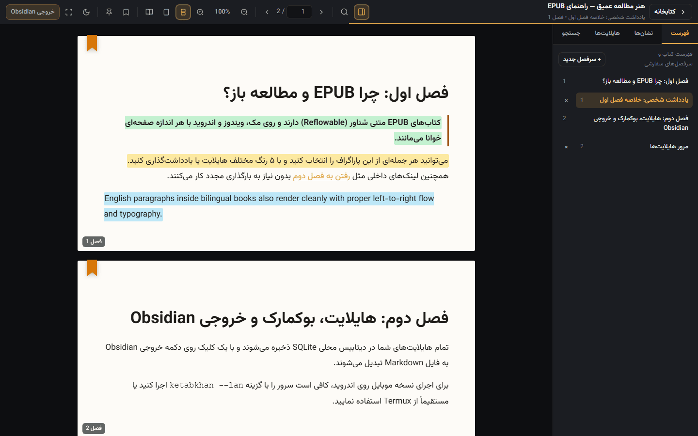
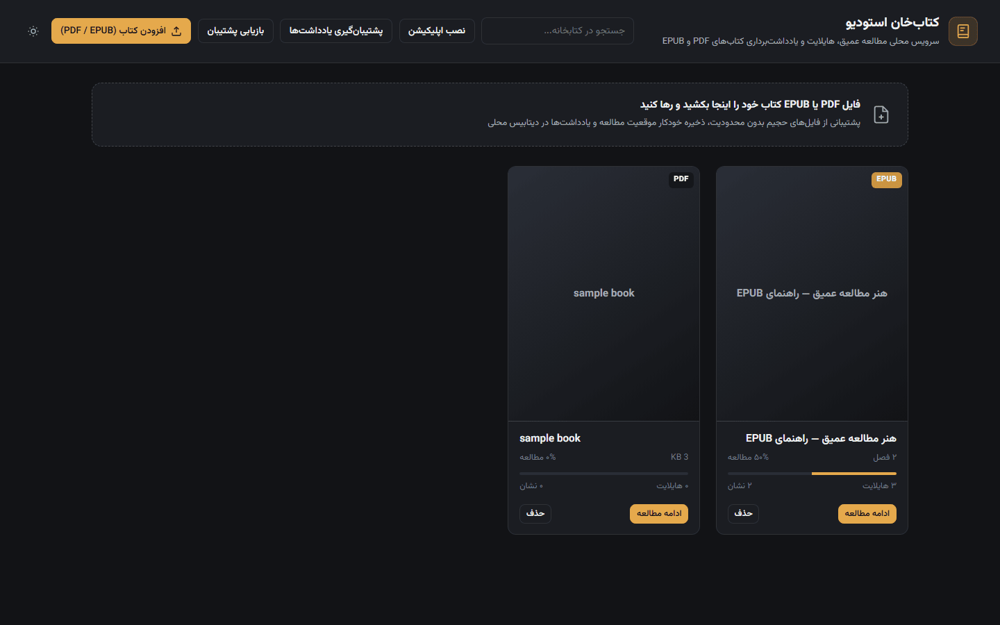
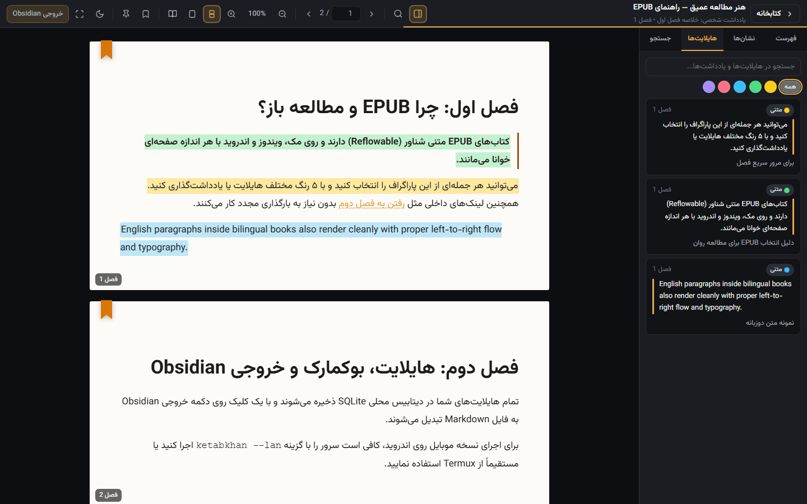
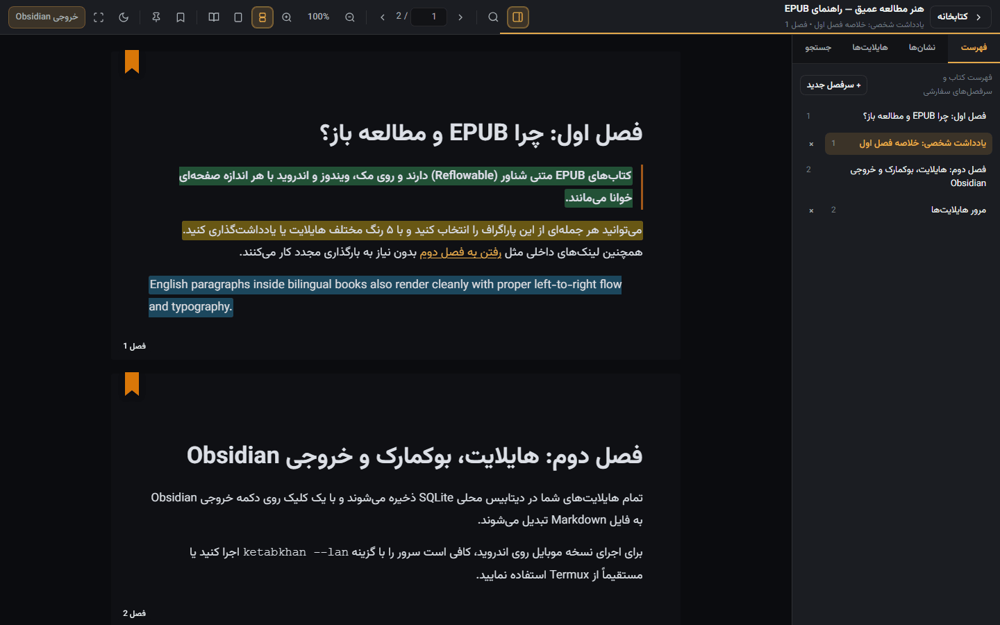
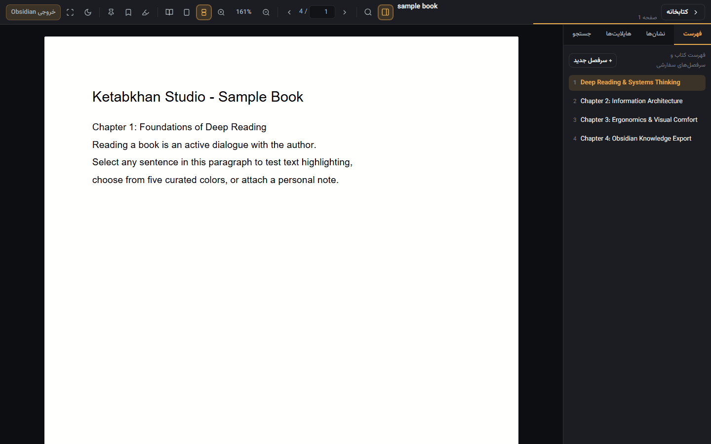
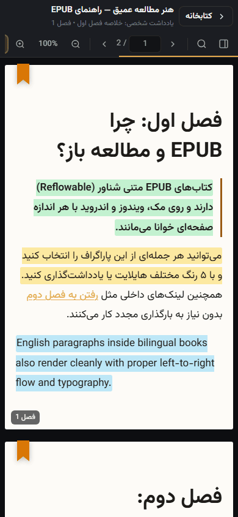

<div dir="rtl" align="right">

# کتاب‌خان استودیو (Ketabkhan Studio)

**کتاب‌خوان محلی، سریع و حرفه‌ای برای فایل‌های PDF و EPUB — با پشتیبانی از متون فارسی و انگلیسی (RTL/LTR)، هایلایت دوحالته، بوکمارک، فهرست هوشمند، خروجی Obsidian و اپلیکیشن بومی برای مک، ویندوز و اندروید.**

[بازگشت به README دوزبانه](./README.md)



| کتابخانه | هایلایت‌ها و یادداشت‌ها |
| --- | --- |
|  |  |
| **تم شب (Midnight)** | **خواندن PDF** |
|  |  |

<p align="center"></p>

---

## ✍️ قلم S Pen (گلکسی اولترا، تبلت و قلم‌های دیگر)

- **قاعده ساده:** قلم می‌نویسد و انگشت اسکرول می‌کند؛ نیازی به تعویض حالت نیست. نوار ابزار قلم با اولین تشخیص قلم پایین صفحه ظاهر می‌شود (دکمه ✕ آن را خاموش می‌کند و دکمه قلم در نوار بالا دوباره روشنش می‌کند).
- **هایلایت با قلم:** قلم را روی متن بکشید؛ در EPUB و PDF هایلایت متنی واقعی ساخته می‌شود و در صفحه‌های اسکن‌شده، کادر کشیده‌شده هایلایت ناحیه‌ای می‌شود.
- **یادداشت دست‌نویس:** روی PDF مستقیم روی صفحه بنویسید. در EPUB متن جاری است، پس روی متن بزنید تا کارت یادداشت دست‌نویس باز شود؛ این کارت با یک نشانه در حاشیه و در پنل هایلایت‌ها دیده می‌شود.
- **پاک‌کن:** دکمه کناری قلم را نگه دارید و روی خط بکشید، یا ابزار پاک‌کن را انتخاب کنید.
- **ضخامت و رنگ:** سه ضخامت (ریز، متوسط، درشت) که با فشار قلم تغییر می‌کند؛ پنج رنگ هایلایت و سه رنگ جوهر (مشکی، آبی، قرمز).
- **ذخیره و خروجی:** یادداشت‌های دست‌نویس در پشتیبان کتابخانه هستند و در خروجی Obsidian به صورت تصویر SVG می‌آیند.

---

## 📲 نصب‌کننده‌های یک‌کلیکی برنامه (One-Click App Installers)

فایل نصبی دستگاه خود را از [**صفحه Releases گیتهاب**](https://github.com/am333ni7y/book-reader-studio/releases/latest) دانلود کنید و فقط با لمس یا کلیک روی آیکون برنامه اجرا کنید:

- **مک (macOS):** فایل `.dmg` را باز کنید، **Ketabkhan Studio** را در پوشه `Applications` بگذارید و روی آیکون آن دابل‌کلیک کنید.
- **ویندوز (Windows):** فایل `Ketabkhan-Studio-Windows-Setup.exe` (یا نسخه `Portable.exe` بدون نیاز به نصب) را اجرا کنید و روی آیکون دسکتاپ کلیک کنید.
- **اندروید (Android):** فایل `Ketabkhan-Studio-Android.apk` را روی گوشی نصب کنید و آیکون **کتاب‌خان استودیو** را باز کنید (کاملاً آفلاین و مستقل، بدون نیاز به کامپیوتر یا ترموکس).

### یادداشت‌های نصب
- **ویندوز:** فایل‌های ویندوز هنوز امضای دیجیتال ندارند. ممکن است SmartScreen پیام «Windows protected your PC» را نشان دهد. روی **More info** و سپس **Run anyway** کلیک کنید.
- **مک:** فایل‌های مک امضا و notarize نشده‌اند. روی برنامه راست‌کلیک کنید و **Open** را بزنید، یا در ترمینال این دستور را اجرا کنید: `xattr -dr com.apple.quarantine "/Applications/Ketabkhan Studio.app"`
- **اندروید (ارتقا از v3.0.0):** نسخه v3.0.0 با یک کلید موقت امضا شده، بنابراین نسخه بعدی روی آن نصب نمی‌شود. ابتدا یادداشت‌ها را با خروجی Obsidian ذخیره کنید، سپس v3.0.0 را حذف و APK جدید را نصب کنید. هایلایت‌ها و بوکمارک‌های داخل برنامه با حذف آن از بین می‌روند.
- **حالت LAN:** دستور `ketabkhan --lan` آدرسی چاپ می‌کند که با `?token=...` تمام می‌شود. این آدرس دقیق را یک بار در مرورگر گوشی باز کنید؛ پس از آن کوکی ذخیره می‌شود. برای ثابت ماندن توکن، متغیر محیطی `KETABKHAN_TOKEN` را تنظیم کنید.

---

## نصب سریع از طریق کامندلاین (اختیاری)

### مک (macOS) و لینوکس
```bash
curl -fsSL https://raw.githubusercontent.com/am333ni7y/book-reader-studio/main/install.sh | bash
ketabkhan --open
```

### ویندوز (PowerShell)
```powershell
irm https://raw.githubusercontent.com/am333ni7y/book-reader-studio/main/install.ps1 | iex
ketabkhan --open
```

### اندروید (Termux — اجرای آفلاین در ترمینال)
```bash
pkg update -y && pkg install -y curl
curl -fsSL https://raw.githubusercontent.com/am333ni7y/book-reader-studio/main/install.sh | bash
ketabkhan --open
```

---

## دستورات کاربردی CLI
- `ketabkhan start --open`: اجرای سرور و باز شدن مرورگر
- `ketabkhan add /path/to/book.epub`: افزودن کتاب EPUB یا PDF از ترمینال
- `ketabkhan seed`: ساخت کتاب‌های نمونه PDF و EPUB
- `ketabkhan doctor`: بررسی سلامت Node.js، SQLite و مسیرهای ذخیره‌سازی

</div>
