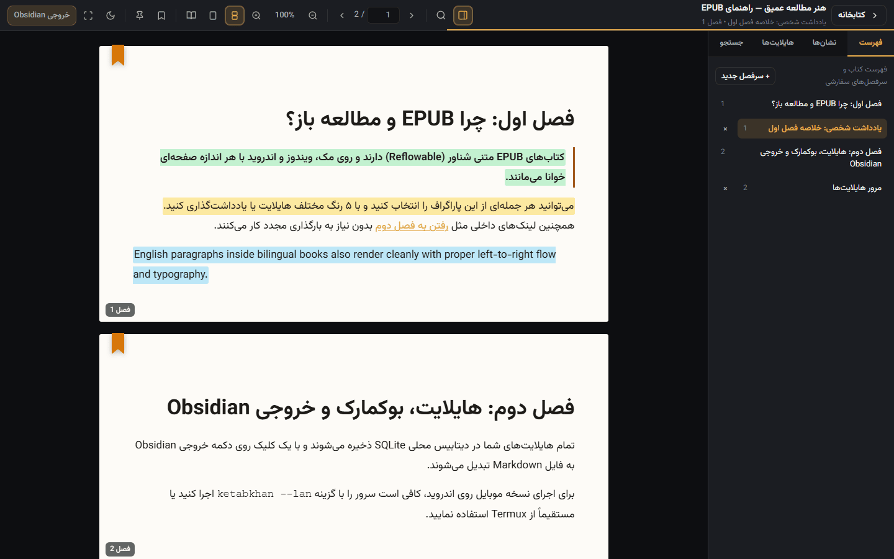
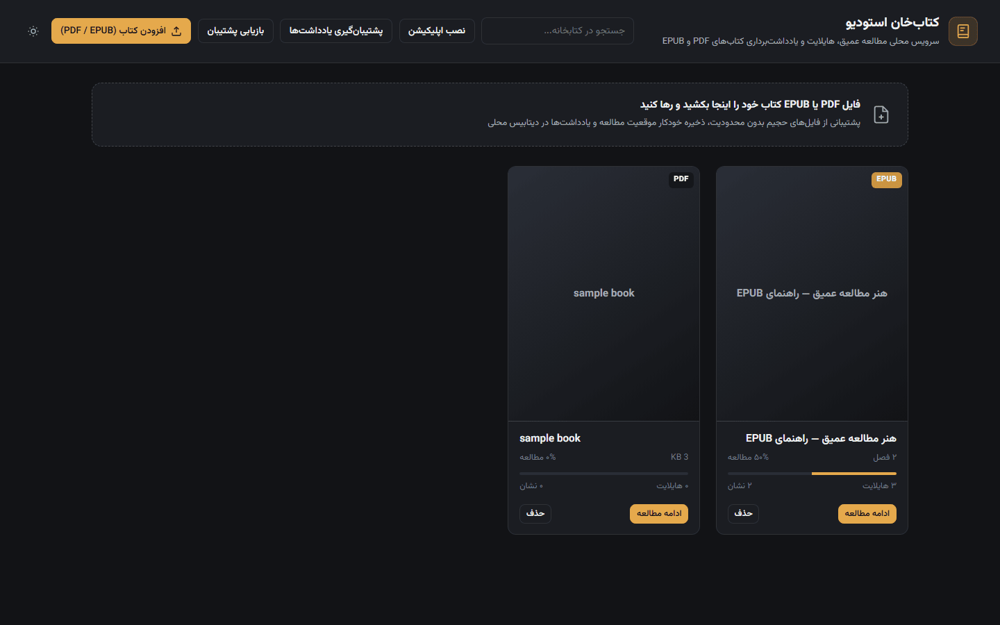
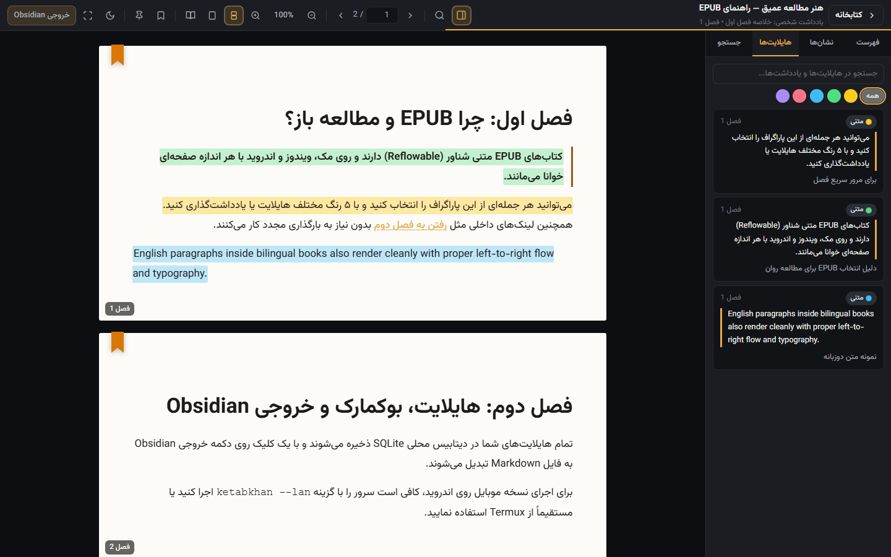
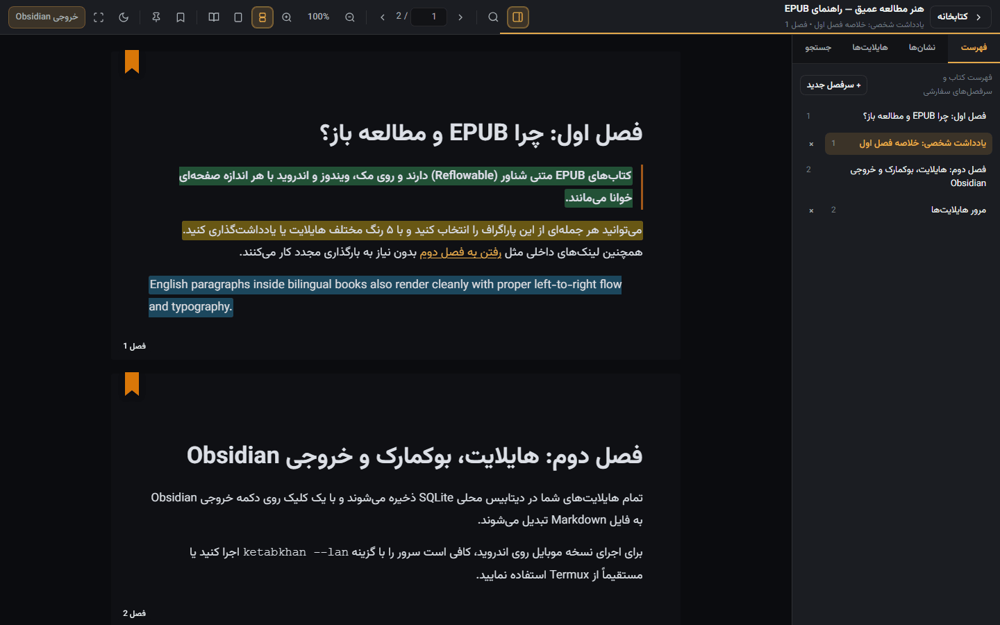
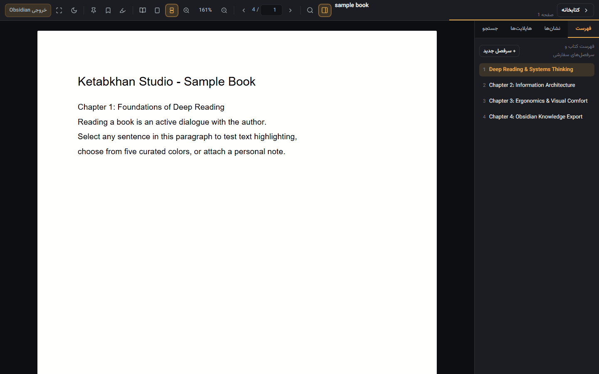
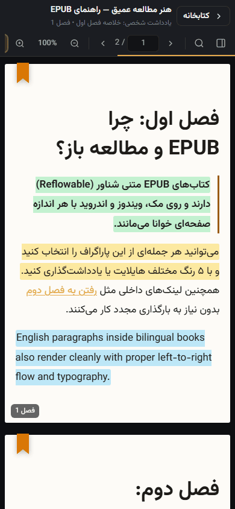

# Ketabkhan Studio (کتاب‌خان استودیو)

**A fast, local-first PDF & EPUB Book Reader Studio with bilingual RTL/LTR typography, dual-mode & reflowable highlighting, bookmarks, smart TOC, and 1-click Obsidian Markdown export — running on macOS, Windows, and Android.**

[🇬🇧 English Documentation](#english-documentation) | [🇮🇷 مستندات کامل فارسی](#persian-documentation) ([README.fa.md](./README.fa.md))




---

<a id="english-documentation"></a>

## 🇬🇧 English Documentation

### Why Ketabkhan Studio?
Most self-hosted readers either require Docker/PostgreSQL stacks or struggle with Persian/Arabic RTL typography, scanned PDFs, and Obsidian note-taking workflows. **Ketabkhan Studio** runs in a single Node.js process with zero external database servers, zero cloud tracking, and first-class support for both **PDF** and **EPUB** books.

### Key Features
- **Dual Format Engine (PDF + EPUB 2/3)**:
  - **PDF**: Powered by `pdfjs-dist` v6 with HTTP `206 Partial Content` range streaming for 300MB+ books, isolated LTR canvas rendering, and smart Persian Presentation-Form (`U+FB50–U+FEFF`) BiDi text reconstruction.
  - **EPUB**: Zero-dependency Node.js ZIP/OPF/Nav/NCX parser with lazy chapter streaming, scoped book styles, internal chapter links, cover extraction, and full-text search.
- **Highlighting & Notes**:
  - **PDF Text & Area Highlighting**: Select text on digital PDFs or draw rectangular area highlights on scanned PDFs without selectable text layers.
  - **EPUB Reflowable Highlighting**: Persistent character-offset highlights (`<mark>`) across font scales and themes, with touch-handle support on Android.
  - **5 Curated Colors + Notes + Filters**: Amber, Sage, Sky, Coral, and Lavender with instant sidebar filtering.
- **Bookmarks & Named Page Pins**:
  - Quick ribbon bookmark (`B`) and categorized special pins (`P`) with custom labels and notes.
- **Smart & Custom Table of Contents**:
  - Extracts native PDF outlines and EPUB 2/3 TOCs, plus lets you add custom chapters for scanned books.
- **Reading Ergonomics**:
  - 4 reading themes (`Paper`, `Sepia`, `Smart Dark`, `Midnight`), brightness & warmth sliders, Scroll / Single / Two-Page Spread (`RTL` & `LTR`), and distraction-free Zen Mode (`F`).
- **1-Click Obsidian Export**:
  - Compiles your progress, custom TOC, pins, highlights, and notes into a structured Markdown file with YAML frontmatter.
- **S Pen & Stylus (Galaxy Ultra, tablets, Wacom)**:
  - The pen writes, your finger scrolls; no mode switch. A pen toolbar appears the first time a pen is detected.
  - **Highlight:** drag the pen over text (EPUB or PDF). On scanned PDF pages the dragged box becomes an area highlight.
  - **Handwriting:** write directly on PDF pages; on EPUB, tap the text to open a handwritten note card that stays anchored in the margin.
  - **Eraser:** hold the S Pen side button (or pick the eraser) and rub over a stroke. Three sizes, pressure-sensitive; ink in black, blue or red.
  - Ink is saved with your highlights, included in the library backup, and exported to Obsidian as inline SVG.

### Screenshots

| Library | Highlights & notes |
| --- | --- |
|  |  |
| **Midnight theme** | **PDF reader** |
|  |  |

<p align="center"></p>

---

### 📲 One-Click App Installers

Download the installer for your device from [**GitHub Releases**](https://github.com/am333ni7y/book-reader-studio/releases/latest) and open it directly by clicking the app icon:

| Platform | Installer File | How to Launch |
| --- | --- | --- |
| **macOS (Apple Silicon & Intel)** | `Ketabkhan-Studio-macOS-AppleSilicon.dmg` / `Ketabkhan-Studio-macOS-Intel.dmg` | Drag **Ketabkhan Studio** to **Applications** and double-click the icon. |
| **Windows (10 / 11)** | `Ketabkhan-Studio-Windows-Setup.exe` (or `Portable.exe`) | Run installer, then double-click **Ketabkhan Studio** on Desktop / Start Menu. |
| **Android (APK)** | `Ketabkhan-Studio-Android.apk` | Tap the APK to install, then tap the **کتاب‌خان استودیو** icon on your Home Screen (100% offline!). |

**Installer notes**
- **Windows:** builds are not code-signed yet. SmartScreen may show "Windows protected your PC". Click **More info**, then **Run anyway**.
- **macOS:** builds are not signed or notarized. Right-click the app and choose **Open**, or run `xattr -dr com.apple.quarantine "/Applications/Ketabkhan Studio.app"` in Terminal.
- **Signing:** builds are signed automatically once the maintainer configures signing secrets; see [docs/RELEASING.md](docs/RELEASING.md) (Code signing).
- **Android (upgrading from v3.0.0):** v3.0.0 was signed with a temporary key, so the next version cannot install over it. Export your notes first (Obsidian export), uninstall v3.0.0, then install the new APK. Highlights and bookmarks stored inside the app are removed with it.

---

### Quick CLI Installation (Optional — For Developers)

> **Requirement:** Node.js `>= 22.5.0` (built-in `node:sqlite`). The installers below automatically check/install Node.js where possible.

#### macOS & Linux
```bash
curl -fsSL https://raw.githubusercontent.com/am333ni7y/book-reader-studio/main/install.sh | bash
```
Then launch from anywhere:
```bash
ketabkhan --open
```

#### Windows (PowerShell)
```powershell
irm https://raw.githubusercontent.com/am333ni7y/book-reader-studio/main/install.ps1 | iex
```
Restart your terminal (or double-click `start.bat`), then run:
```powershell
ketabkhan --open
```

#### Android — Option 1: Native Standalone via Termux (Offline on Phone)
1. Install **Termux** (from F-Droid or GitHub Releases).
2. Run:
   ```bash
   pkg update -y && pkg install -y curl
   curl -fsSL https://raw.githubusercontent.com/am333ni7y/book-reader-studio/main/install.sh | bash
   ```
3. Launch with:
   ```bash
   ketabkhan --open
   ```
   *(The installer also creates a 1-tap `~/.shortcuts/Ketabkhan Studio` launcher for **Termux:Widget**!)*

#### Android — Option 2: Wi-Fi LAN + Installable PWA (Read from PC Library)
Start the server on your Mac/Windows machine with `--lan`:
```bash
ketabkhan --lan
```
LAN mode requires a token. `ketabkhan --lan` prints a URL ending in `?token=...`. Open that exact URL once on the phone; a cookie is then set, so you do not need it again. To keep the same token across restarts, set the `KETABKHAN_TOKEN` environment variable.

Then open the printed LAN URL (e.g., `http://192.168.1.25:3847/?token=...`) in Chrome on Android and tap **Install App** / **Add to Home Screen**.

---

### CLI Reference

| Command | Description |
| --- | --- |
| `ketabkhan` / `ketabkhan start` | Start local server on `http://127.0.0.1:3847` |
| `ketabkhan --open` | Start server and open your default browser |
| `ketabkhan --lan` | Bind `0.0.0.0` and print LAN URLs for Android/tablet |
| `ketabkhan --port 4000` | Use a custom port |
| `ketabkhan add <book.pdf\|book.epub>` | Import a PDF or EPUB directly from the terminal |
| `ketabkhan seed` | Seed sample PDF & bilingual EPUB books |
| `ketabkhan doctor` | Verify Node.js, `node:sqlite`, OS, and storage paths |

### Configuration (Optional `.env` or Environment Variables)
- `PORT`: Server port (default: `3847`)
- `HOST`: Bind host (default: `127.0.0.1`)
- `KETABKHAN_DATA_DIR`: Custom directory for `library.sqlite` and uploaded books
- `OBSIDIAN_NOTES_DIR`: Target directory for 1-click Obsidian Markdown exports (defaults to `~/Documents/Ketabkhan-Notes`)
- `KETABKHAN_TOKEN`: Fixed access token for `--lan` mode. If unset, a new token is generated at each start and printed in the URL.

### Keyboard Shortcuts
- `B`: Toggle quick ribbon bookmark
- `P`: Pin current page/chapter with label & category
- `T`: Toggle sidebar (TOC, Bookmarks, Highlights, Search)
- `F`: Toggle distraction-free Zen Mode
- `Ctrl/Cmd + F`: Search inside book
- `J / K` or Arrow keys: Turn pages/chapters in Single & Spread modes

---

<a id="persian-documentation"></a>

<div dir="rtl" align="right">

## 🇮🇷 مستندات کامل فارسی

### معرفی کتاب‌خان استودیو (Ketabkhan Studio)
**کتاب‌خان استودیو** یک سرویس کتاب‌خوان محلی، سریع و بدون نیاز به اینترنت یا داکر است که به طور ویژه برای مطالعه عمیق کتاب‌های **PDF** و **EPUB** (فارسی، انگلیسی و دوزبانه) طراحی شده است. تمام کتاب‌ها، هایلایت‌ها، بوکمارک‌ها و یادداشت‌های شما در دیتابیس محلی SQLite ذخیره می‌شوند و با یک کلیک می‌توانید خروجی Markdown برای **Obsidian** بگیرید.

### قابلیت‌های کلیدی
- **پشتیبانی کامل از PDF و EPUB (نسخه ۲ و ۳):**
  - **PDF:** موتور `pdfjs-dist` با استریم HTTP `206` برای کتاب‌های حجیم، ایزوله‌سازی بوم رندر برای نمایش بی‌نقص متون انگلیسی و فارسی، و نرمال‌سازی هوشمند متون دوزبانه.
  - **EPUB:** پارسر بومی و بدون وابستگی (Pure Node.js) با بارگذاری سریع فصل‌به‌فصل، حفظ استایل کتاب، لینک‌های داخلی بین فصل‌ها، استخراج خودکار جلد و فهرست، و جستجو در کل کتاب.
- **هایلایت دوحالته + هایلایت متنی در EPUB:**
  - انتخاب متن در PDFهای متنی و کتاب‌های EPUB، به‌علاوه ابزار **«هایلایت ناحیه‌ای»** (کشیدن کادر) برای PDFهای اسکن‌شده فارسی، همراه با ۵ رنگ و یادداشت‌گذاری.
  - پشتیبانی از انتخاب متن لمسی (Touch Selection) روی گوشی‌های **اندروید**.
- **بوکمارک سریع و نشان‌گذاری ویژه:**
  - روبان بوکمارک سریع (`B`) و نشان ویژه با عنوان، دسته‌بندی و یادداشت (`P`).
- **فهرست هوشمند و سفارشی:**
  - استخراج خودکار فهرست داخلی PDF و EPUB + امکان افزودن سرفصل دلخواه برای کتاب‌های فاقد فهرست.
- **ارگونومی مطالعه:**
  - ۴ تم خوانایی (`کاغذ سفید`، `سپیا`، `شب هوشمند`، `تیره اصلی`)، تنظیم روشنایی و گرمای نور، حالت دوصفحه‌ای کتابی (راست‌به‌چپ و چپ‌به‌راست) و حالت متمرکز (`F`).
- **خروجی مستقیم به Obsidian:**
  - تبدیل تمام هایلایت‌ها، نقل‌قول‌ها، نشان‌ها و پیشرفت مطالعه به یک فایل Markdown ساختاریافته.
- **پشتیبانی از S Pen و قلم (گلکسی اولترا، تبلت، Wacom):**
  - قلم می‌نویسد و انگشت اسکرول می‌کند؛ بدون تعویض حالت. نوار ابزار قلم با اولین تشخیص قلم ظاهر می‌شود.
  - **هایلایت:** قلم را روی متن بکشید (EPUB یا PDF). در صفحه‌های اسکن‌شده، کادر کشیده‌شده هایلایت ناحیه‌ای می‌شود.
  - **دست‌نویس:** روی صفحه PDF مستقیم بنویسید؛ در EPUB روی متن بزنید تا کارت یادداشت دست‌نویس باز شود و کنار متن در حاشیه بماند.
  - **پاک‌کن:** دکمه کناری S Pen را نگه دارید (یا پاک‌کن را انتخاب کنید) و روی خط بکشید. سه ضخامت، حساس به فشار؛ جوهر مشکی، آبی یا قرمز.
  - یادداشت‌های دست‌نویس همراه هایلایت‌ها ذخیره می‌شوند، در پشتیبان کتابخانه هستند و به Obsidian به صورت SVG خروجی می‌گیرند.

### تصاویر برنامه

| کتابخانه | هایلایت‌ها و یادداشت‌ها |
| --- | --- |
|  |  |
| **تم شب (Midnight)** | **خواندن PDF** |
|  |  |

<p align="center"></p>

---

### 📲 نصب‌کننده‌های یک‌کلیکی برنامه (One-Click App Installers)

فایل نصبی مخصوص دستگاه خود را از صفحه [**GitHub Releases**](https://github.com/am333ni7y/book-reader-studio/releases/latest) دانلود کنید و فقط با کلیک روی آیکون برنامه آن را باز کنید:

| سیستم‌عامل | فایل نصبی | روش اجرا |
| --- | --- | --- |
| **مک (macOS)** | `Ketabkhan-Studio-macOS-AppleSilicon.dmg` / `Intel.dmg` | برنامه **Ketabkhan Studio** را به پوشه Applications بکشید و روی آیکون آن دابل‌کلیک کنید. |
| **ویندوز (Windows 10/11)** | `Ketabkhan-Studio-Windows-Setup.exe` یا `Portable.exe` | فایل را اجرا کنید و سپس روی آیکون **Ketabkhan Studio** در دسکتاپ یا منوی استارت کلیک کنید. |
| **اندروید (Android APK)** | `Ketabkhan-Studio-Android.apk` | فایل APK را روی گوشی نصب کنید و آیکون **کتاب‌خان استودیو** را لمس کنید (کاملاً آفلاین!). |

**یادداشت‌های نصب**
- **ویندوز:** فایل‌های ویندوز هنوز امضای دیجیتال ندارند. ممکن است SmartScreen پیام «Windows protected your PC» را نشان دهد. روی **More info** و سپس **Run anyway** کلیک کنید.
- **مک:** فایل‌های مک امضا و notarize نشده‌اند. روی برنامه راست‌کلیک کنید و **Open** را بزنید، یا در ترمینال این دستور را اجرا کنید: `xattr -dr com.apple.quarantine "/Applications/Ketabkhan Studio.app"`
- **امضای خودکار:** به محض اینکه نگه‌دارنده پروژه اطلاعات امضا (secrets) را تنظیم کند، فایل‌های ویندوز و مک خودکار امضا می‌شوند؛ جزئیات در [docs/RELEASING.md](docs/RELEASING.md) (بخش Code signing).
- **اندروید (ارتقا از v3.0.0):** نسخه v3.0.0 با یک کلید موقت امضا شده، بنابراین نسخه بعدی روی آن نصب نمی‌شود. ابتدا یادداشت‌ها را با خروجی Obsidian ذخیره کنید، سپس v3.0.0 را حذف و APK جدید را نصب کنید. هایلایت‌ها و بوکمارک‌های داخل برنامه با حذف آن از بین می‌روند.

---

### نصب سریع از طریق کامندلاین (اختیاری — برای توسعه‌دهندگان)

> **پیش‌نیاز:** نسخه `Node.js >= 22.5.0` (دارای `node:sqlite` داخلی). اسکریپت‌های نصبی زیر در صورت نبودن Node.js، آن را به صورت خودکار نصب می‌کنند.

#### ۱. نصب روی مک (macOS) و لینوکس
```bash
curl -fsSL https://raw.githubusercontent.com/am333ni7y/book-reader-studio/main/install.sh | bash
```
سپس در ترمینال اجرا کنید:
```bash
ketabkhan --open
```

#### ۲. نصب روی ویندوز (PowerShell)
```powershell
irm https://raw.githubusercontent.com/am333ni7y/book-reader-studio/main/install.ps1 | iex
```
پس از اتمام نصب، یک بار ترمینال را ببندید و باز کنید (یا روی فایل `start.bat` کلیک کنید) و دستور زیر را بزنید:
```powershell
ketabkhan --open
```

#### ۳. اجرا روی اندروید — روش اول: نصب مستقیم و آفلاین با Termux
1. برنامه **Termux** را (از F-Droid یا GitHub) نصب کنید.
2. دستورات زیر را اجرا کنید:
   ```bash
   pkg update -y && pkg install -y curl
   curl -fsSL https://raw.githubusercontent.com/am333ni7y/book-reader-studio/main/install.sh | bash
   ```
3. برای اجرا:
   ```bash
   ketabkhan --open
   ```
   *(اسکریپت نصب، یک میانبر آماده در `~/.shortcuts/Ketabkhan Studio` نیز برای ویجت **Termux:Widget** می‌سازد تا با یک لمس اجرا شود.)*

#### ۴. اجرا روی اندروید — روش دوم: اتصال وای‌فای (LAN) و نصب به عنوان PWA
روی کامپیوتر (مک یا ویندوز) دستور زیر را بزنید:
```bash
ketabkhan --lan
```
حالت LAN به توکن نیاز دارد: دستور بالا آدرسی چاپ می‌کند که با `?token=...` تمام می‌شود. همین آدرس دقیق را یک بار در مرورگر کروم گوشی باز کنید؛ پس از آن کوکی ذخیره می‌شود و دیگر لازم نیست. برای ثابت ماندن توکن بین اجراها، متغیر محیطی `KETABKHAN_TOKEN` را تنظیم کنید.

سپس آدرس نمایش‌داده‌شده (مثلاً `http://192.168.1.25:3847/?token=...`) را باز کنید و گزینه **نصب اپلیکیشن / Add to Home Screen** را بزنید.

---

### دستورات کامندلاین (`ketabkhan`)

| دستور | کاربرد |
| --- | --- |
| `ketabkhan` یا `ketabkhan start` | اجرای سرور محلی روی `http://127.0.0.1:3847` |
| `ketabkhan --open` | اجرای سرور و باز کردن خودکار مرورگر |
| `ketabkhan --lan` | باز کردن دسترسی در شبکه وای‌فای برای گوشی اندروید و تبلت |
| `ketabkhan --port 4000` | اجرا روی پورت دلخواه |
| `ketabkhan add <book.pdf\|book.epub>` | افزودن مستقیم کتاب PDF یا EPUB از طریق ترمینال |
| `ketabkhan seed` | افزودن کتاب‌های نمونه PDF و EPUB دوزبانه |
| `ketabkhan doctor` | بررسی وضعیت Node.js، SQLite، سیستم‌عامل و مسیرها |

### کلیدهای میانبر در محیط مطالعه
- `B`: بوکمارک سریع صفحه یا فصل فعلی
- `P`: نشان‌گذاری ویژه با عنوان و دسته‌بندی
- `T`: باز و بسته کردن پنل کناری (فهرست، نشان‌ها، هایلایت‌ها، جستجو)
- `F`: حالت مطالعه متمرکز (تمام‌صفحه)
- `Ctrl/Cmd + F`: جستجو در متن کل کتاب
- `J / K` یا کلیدهای جهت: ورق زدن در حالت تک‌صفحه‌ای و دوصفحه‌ای

</div>
