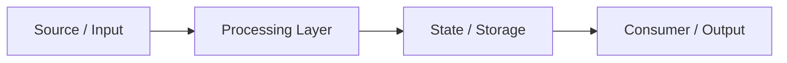

# Milestone Technical Synthesis & Decision Defense

- **Project / Milestone Name**: [e.g., v1.0 Core Engine Release]
- **Milestone Date**: [YYYY-MM-DD]
- **Authors & Contributors**: [Names / Roles]
- **Scope Covered**: [Brief description of modules, services, or features completed]

---

## 1. WHAT DID WE BUILD?
*A precise, technical summary of the actual deliverables, components, and capabilities delivered.*

---

## 2. WHY DID WE BUILD IT?
*The concrete requirement, business driver, performance bottleneck, research question, or operational need that mandated this work.*

---

## 3. HOW DOES IT WORK?
*High-level architecture, data flows, core components, and interaction patterns (include a Mermaid diagram where appropriate).*

---

## 4. WHY DID WE IMPLEMENT IT THIS WAY?
*The technical and practical reasoning justifying the chosen design pattern, architecture, algorithms, and dependencies.*

---

## 5. WHAT ALTERNATIVES DID WE HAVE?
*The realistic alternative architectures, frameworks, models, algorithms, or approaches considered.*

---

## 6. WHY DID WE NOT CHOOSE THEM?
*Concrete reasons each alternative was rejected (e.g., latency, maintainability, resource consumption, cost, operational complexity).*

---

## 7. WHAT EVIDENCE SUPPORTS THE DECISION?
*Benchmarks, profile traces, error logs, user feedback, or controlled experiments supporting the selected approach. Distinguish observed facts from interpretations and assumptions.*

---

## 8. WHAT WENT WRONG?
*Unexpected behaviors, bugs, dead ends, wrong assumptions, failed tests, and abandoned approaches encountered during development.*

---

## 9. HOW DID WE DISCOVER IT?
*Telemetry, test suites, reproducing steps, error traces, or diagnostic methods that uncovered the issues.*

---

## 10. HOW DID WE FIX IT?
*The diagnosis, investigated solutions, and selected fix applied to resolve each failure.*

---

## 11. WHAT DID WE LEARN?
*Generalizable engineering lessons, technical insights, and mental-model corrections extracted from the cycle.*

---

## 12. WHAT TRADE-OFFS DID WE ACCEPT?
*What was gained versus what was sacrificed (speed vs simplicity, flexibility vs strictness, memory vs CPU).*

---

## 13. WHAT LIMITATIONS REMAIN?
*Current technical debt, unhandled edge cases, scaling limits, or boundaries that are known and accepted.*

---

## 14. WHAT CHANGED FROM THE PREVIOUS VERSION?
*The diff between the prior implementation (if any) and the current state.*

---

## 15. WHY DID IT CHANGE?
*The exact triggers, discoveries, or altered requirements that drove the evolution.*

---

## 16. WHAT SHOULD HAPPEN NEXT?
*Concrete next steps, follow-up backlog items, planned refactors, or future milestones.*
